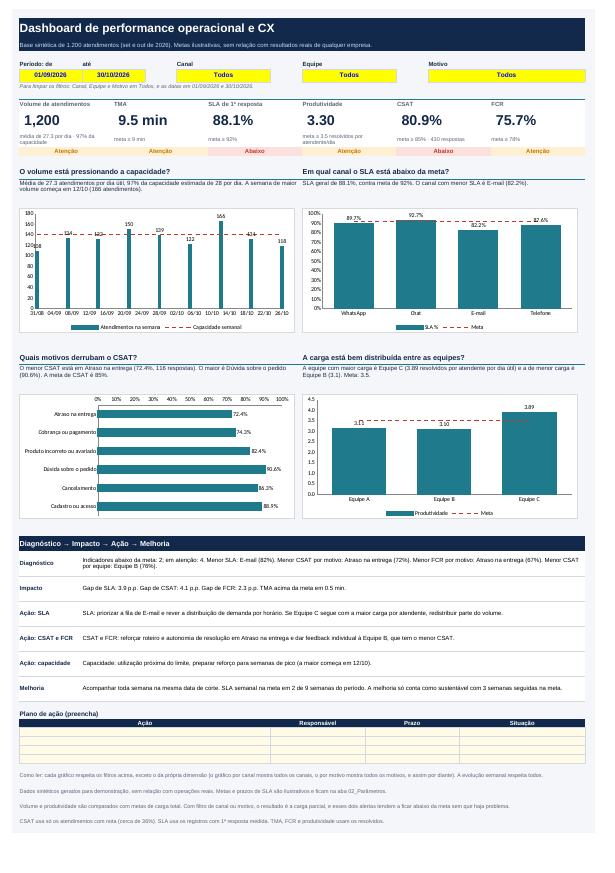
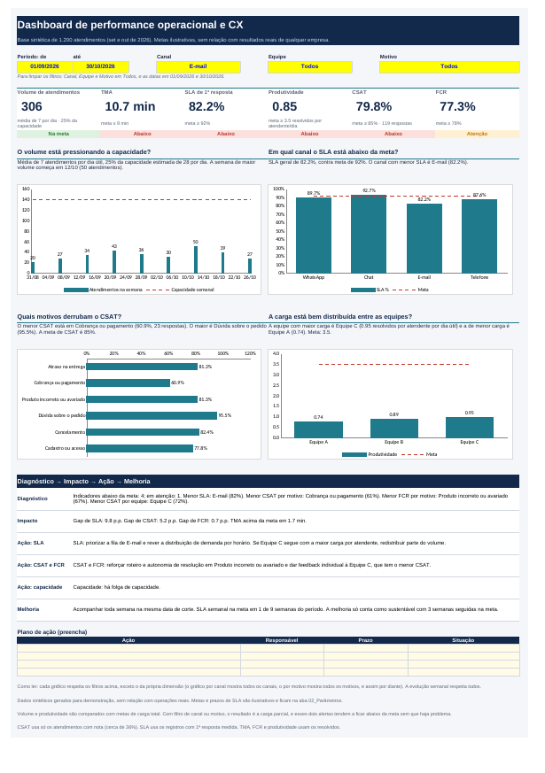

[README (2).md](https://github.com/user-attachments/files/33405395/README.2.md)

# Dashboard de performance operacional e CX no Excel

Projeto de portfólio que mostra como transformar indicadores de uma operação de atendimento em diagnóstico, plano de ação e acompanhamento de melhoria, usando só Excel. A base é sintética (1.200 atendimentos fictícios), e as metas são ilustrativas. Nada aqui representa resultado real de uma empresa ou de um empregador anterior.

Arquivo principal: [`dashboard_performance_operacional_cx.xlsx`](dashboard_performance_operacional_cx.xlsx)



## Problema e objetivo

Um líder de operação precisa responder, toda semana, quatro coisas: como estamos, onde está o problema, o que fazer e se o que foi feito funcionou. O dashboard organiza essa rotina:

1. Monitorar: volume, TMA, SLA, produtividade, CSAT e FCR contra metas.
2. Diagnosticar: apontar o canal, o motivo e a equipe com pior resultado.
3. Agir: sugerir ajustes de priorização, distribuição de demanda, capacidade e desenvolvimento da equipe, com um plano de ação para preencher.
4. Melhorar: acompanhar se o SLA semanal se mantém na meta por semanas seguidas.

## Origem dos dados

A base foi gerada por um script com semente fixa, com comportamento plausível e propositalmente desigual, para o dashboard ter o que diagnosticar:

1. 1.200 atendimentos abertos em dias úteis de 01/09/2026 a 30/10/2026, com uma semana de pico em 12 a 16/10.
2. Quatro canais (WhatsApp, Chat, E-mail e Telefone), seis motivos, oito atendentes em três equipes.
3. A Equipe C tem menos gente e maior carga, e vai pior em SLA e FCR. A Equipe B tem o menor CSAT. E-mail tem o pior SLA. Atraso na entrega tem o menor CSAT e FCR.
4. Metas e prazos de SLA são ilustrativos e ficam na aba 02_Parâmetros.

## Estrutura do arquivo

| Aba | Finalidade |
|---|---|
| 01_Base | Tabela `tbAtendimentos`: 11 colunas de dados e 3 calculadas (semana, prazo de SLA do canal e se ficou dentro do SLA) |
| 02_Parâmetros | Metas ilustrativas, sentido e tolerância, prazo de SLA por canal, atendentes e equipes, listas e regras de elegibilidade |
| 03_Dashboard | Filtros, seis indicadores com alerta, quatro gráficos, diagnóstico, ação, melhoria e plano de ação |
| 04_Validacao | Testes da base e conferência dos indicadores por outro caminho de cálculo |

## Indicadores e fórmulas

Todos usam a data de abertura e respeitam os quatro filtros. Cada indicador tem seu próprio denominador, com apenas os registros elegíveis:

| Indicador | Cálculo | Elegíveis |
|---|---|---|
| Volume | Contagem de atendimentos, com média por dia útil e utilização da capacidade | Todos |
| TMA | Média de Tempo_Atendimento_min | Status Resolvido |
| SLA de 1ª resposta | Dentro do prazo do canal ÷ elegíveis | Registros com 1ª resposta medida |
| Produtividade | Resolvidos ÷ (atendentes × dias úteis) | Status Resolvido |
| CSAT | Notas 4 e 5 ÷ respostas | Registros com nota (cerca de 36%) |
| FCR | Resolvido no 1º contato ÷ resolvidos | Status Resolvido |

As fórmulas usam `COUNTIFS`, `AVERAGEIFS`, `NETWORKDAYS`, `INDEX` e `MATCH`. Quando o filtro está em Todos, o critério vira `*`, que aceita qualquer texto. Os cálculos de apoio ficam à direita do dashboard, a partir da coluna V.

O status de cada indicador segue uma régua única: na meta, em atenção (dentro da tolerância) ou abaixo da meta. Os alertas dos cartões, o diagnóstico e a ação sugerida leem as metas da aba 02_Parâmetros.

## Filtros

1. Período (data inicial e final).
2. Canal.
3. Equipe.
4. Motivo.

Os quatro funcionam em conjunto. Cada gráfico respeita os outros filtros, mas mostra todas as categorias da própria dimensão: o de SLA mostra todos os canais, o de CSAT mostra todos os motivos, o de produtividade mostra todas as equipes. A evolução semanal respeita todos.

Exemplo: com o canal E-mail, o SLA cai para 82,2%, o volume para 306 atendimentos, e o diagnóstico aponta E-mail como prioridade de fila.



## Validação

A aba 04_Validacao tem três blocos:

1. Treze testes da base: 1.200 linhas, IDs únicos, datas no período, campos obrigatórios, valores dentro das listas, equipe coerente com o cadastro do atendente, notas de 1 a 5, e FCR só nos resolvidos.
2. Recalculo dos seis indicadores por outro caminho (`SUMPRODUCT`) com os filtros atuais do dashboard, comparando com o valor exibido.
3. Valores de referência calculados fora do Excel, com pandas, para a base completa. Esses valores são fixos.

Também testei quatro combinações de filtros comparando o Excel com o pandas, e os seis indicadores bateram em todas. Com a configuração padrão, a aba mostra "Todos os testes passaram".

## Como abrir e reproduzir

1. Abra o arquivo no Excel e vá para a aba 03_Dashboard.
2. Escolha os filtros nas células amarelas.
3. Para mudar as metas, edite as células amarelas da aba 02_Parâmetros.
4. Para usar outra base, cole os dados nas colunas A a K da aba 01_Base, mantendo os nomes de coluna e as listas da aba 02_Parâmetros. As colunas L a N são fórmulas e devem ser estendidas se a base passar de 1.200 linhas, e os intervalos das fórmulas também.
5. Depois de trocar a base, confira a aba 04_Validacao e atualize os valores fixos da última tabela.

## Limitações

1. Dados sintéticos: os valores absolutos de produtividade, volume e CSAT não representam operação real.
2. As fórmulas usam intervalos fixos até a linha 1201, e não referências estruturadas da tabela, para funcionar em mais versões do Excel e no LibreOffice. A tabela `tbAtendimentos` existe, mas as fórmulas não dependem dela.
3. Com filtro de canal ou motivo, o volume e a produtividade passam a medir a carga parcial e ficam abaixo das metas de carga total. A nota na base do dashboard avisa isso.
4. Com poucos registros no filtro, os percentuais oscilam muito. O texto do dashboard mostra o número de respostas de CSAT para isso.
5. O diagnóstico e as ações são regras simples. Não substituem a análise do líder.
6. Testei a renderização no LibreOffice. Confira no Excel os menus suspensos e os gráficos.

## Aprendizados

O que mais pesou neste projeto foi definir bem o denominador de cada indicador antes de construir qualquer gráfico. SLA, CSAT e FCR não usam o mesmo universo: o SLA considera só os atendimentos com primeira resposta medida, o CSAT só os que tiveram nota (cerca de 36%), e o FCR só os resolvidos. Quando misturei esses universos, o número parecia certo e estava errado. Deixar a regra de elegibilidade escrita na aba de parâmetros evitou esse erro.

Também aprendi que o diagnóstico vale mais que o gráfico. O dashboard não para em dizer que o SLA está abaixo da meta: ele aponta o canal, o motivo e a equipe com pior resultado, estima o tamanho do gap e sugere uma ação. Esse é o raciocínio que uso na rotina de liderança de operação: monitorar, diagnosticar, agir e acompanhar se a melhoria se sustenta por semanas seguidas.

Outra lição foi não confiar no resultado só porque o gráfico apareceu. Criei uma aba de validação que recalcula os seis indicadores por outro caminho e compara com o que o dashboard mostra. Testei também combinações de filtros contra um cálculo feito fora do Excel. Isso mostrou um defeito: grupos sem dados apareciam como 0% e eram apontados como o pior. Corrigi e documentei.

Descobri ainda um limite do próprio modelo: com filtro de canal ou motivo, volume e produtividade passam a medir carga parcial e ficam abaixo da meta sem que haja problema. Em vez de esconder isso, deixei um aviso no dashboard.

Usei o Claude como apoio para estruturar as abas, escrever as fórmulas mais longas e gerar a base sintética. A escolha dos indicadores, das regras de elegibilidade e do desenho do diagnóstico foi minha, e conferi os resultados antes de publicar. Os dados são fictícios e as metas são ilustrativas, sem relação com qualquer empresa onde trabalhei.

Na próxima versão, incluiria a comparação com o período anterior e um gráfico de acompanhamento das ações do plano, para ver se cada ação mudou o indicador.

## Estrutura do repositório

```
.
├── README.md
├── dashboard_performance_operacional_cx.xlsx
├── dashboard-preview.png
└── dashboard-preview-filtro.png
```
